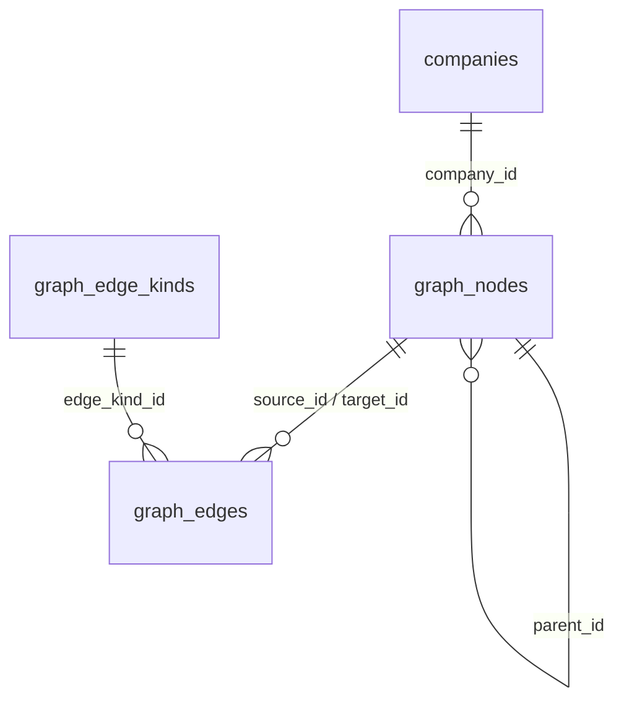

# Netzwerkgraph: Datenmodell

Angelegt durch
[1700000001000_graph.up.sql](../../apps/api/src/db/migrations/1700000001000_graph.up.sql),
zurueckgenommen durch die zugehoerige `.down.sql`. Alle Queries liegen
gebuendelt in
[apps/api/src/modules/graph/repository.ts](../../apps/api/src/modules/graph/repository.ts).



## graph_nodes

Ein Knoten ist entweder eine Ebene oder die Platzierung einer Firma.

| Spalte | Typ | Bedeutung |
| --- | --- | --- |
| `id` | uuid | Primaerschluessel |
| `parent_id` | uuid, nullable | Elternebene; `NULL` bedeutet Wurzelebene |
| `kind` | text | `'layer'` oder `'company'` |
| `company_id` | uuid, nullable | nur bei `kind = 'company'`, Verweis auf `companies` |
| `name` | text, nullable | nur bei `kind = 'layer'` |
| `slug` | text, nullable | nur bei `kind = 'layer'`, Baustein des URL-Pfads |
| `description` | text, nullable | Beschreibungstext der Ebene |
| `color` | text, nullable | optionale Akzentfarbe der Ebene |
| `sort_order` | integer | Reihenfolge in Listen und Layout-Eingabe |
| `created_at`, `updated_at` | timestamptz | |

Die Constraint `graph_nodes_kind_shape` erzwingt, dass je `kind` genau die
passenden Felder gefuellt sind. Damit kann kein Firmen-Knoten mit eigenem Namen
und keine Ebene ohne Slug entstehen.

### Indizes

| Index | Zweck |
| --- | --- |
| `graph_nodes_parent_idx` | Laden eines Scopes; jede Ansicht basiert darauf |
| `graph_nodes_company_idx` | Rueckwaertssuche "wo ist diese Firma platziert" |
| `graph_nodes_company_per_parent_idx` | Firma pro Ebene nur einmal |
| `graph_nodes_company_root_idx` | dasselbe fuer die Wurzel |
| `graph_nodes_slug_per_parent_idx` | Ebenen-Slug pro Elternebene eindeutig |
| `graph_nodes_slug_root_idx` | dasselbe fuer die Wurzel |

Die Aufteilung in je zwei Indizes ist noetig, weil ein UNIQUE-Index zwei Zeilen
mit `parent_id IS NULL` nicht als Duplikat erkennt: In SQL ist `NULL = NULL`
unbekannt, nicht wahr. Die Wurzelebene braucht deshalb einen eigenen partiellen
Index ohne `parent_id` im Schluessel.

## graph_edges

| Spalte | Typ | Bedeutung |
| --- | --- | --- |
| `id` | uuid | Primaerschluessel |
| `scope_id` | uuid, nullable | Ebene, in der die Kante liegt; `NULL` = Wurzel |
| `source_id`, `target_id` | uuid | Endpunkte, beide mit `parent_id = scope_id` |
| `edge_kind_id` | integer | Verbindungstyp, `ON DELETE RESTRICT` |
| `label` | text, nullable | Freitext, ergaenzt den Typ |
| `created_at`, `updated_at` | timestamptz | |

`graph_edges_unique_pair_idx` verhindert Duplikate richtungsunabhaengig ueber
`(edge_kind_id, LEAST(source_id, target_id), GREATEST(source_id, target_id))`.
A nach B und B nach A sind damit dieselbe Kante desselben Typs. `scope_id`
gehoert nicht in den Schluessel, weil ein Knotenpaar ohnehin nur in genau einem
Scope existieren kann.

`ON DELETE RESTRICT` beim Verbindungstyp bedeutet: Ein Typ, der noch verwendet
wird, laesst sich nicht loeschen. Die API faengt das ab und meldet es mit
Nutzungszahl zurueck, statt den Datenbankfehler durchzureichen.

## graph_edge_kinds

Kleine Taxonomie mit `slug`, `name`, `color` (Hex), `directed` und
`sort_order`. Die Migration liefert vier Standardtypen aus: Kooperation,
Liefert an, Forschungspartner, Beteiligung. `directed` steuert ausschliesslich
die Darstellung (Pfeilspitze); gespeichert wird eine Kante immer als Paar aus
`source_id` und `target_id`, die Reihenfolge bleibt also erhalten.

## Invarianten

Vier Regeln, die das Modell tragen. Die ersten beiden kann die Datenbank nicht
selbst pruefen, weil eine `CHECK`-Constraint nur die eigene Zeile sieht; sie
werden im Repository innerhalb einer Transaktion durchgesetzt.

1. **Kanten sind Scope-lokal.** `parent_id` von Quelle und Ziel sind gleich und
   entsprechen `scope_id`. Geprueft in `assertSameScope` vor jedem Insert oder
   Update einer Kante.
2. **`parent_id` bildet einen Baum.** Beim Verschieben einer Ebene darf das neue
   Elternteil kein Nachfahre sein. Geprueft per rekursiver CTE, siehe unten.
3. **Eine Firma je Ebene nur einmal**, per partiellem UNIQUE-Index.
4. **Ebenen-Slug je Elternebene eindeutig**, per partiellem UNIQUE-Index. Der
   Slug entsteht aus dem Namen ueber `uniqueSlug` aus
   [apps/api/src/lib/slug.ts](../../apps/api/src/lib/slug.ts).

Eine fuenfte Regel gilt nur fuer die oeffentliche Sicht: Firmen ohne
`status = 'approved'` werden ausgeblendet, und zwar zusammen mit allen Kanten,
die an ihnen haengen. Das passiert in der Aufbereitung, nicht in der Datenbank,
damit im Admin weiterhin der vollstaendige Graph sichtbar ist.

## Wiederkehrende SQL-Muster

### Scope laden

`IS NOT DISTINCT FROM` behandelt die Wurzel ohne Sonderfall, weil es `NULL`
mit `NULL` als gleich wertet:

```sql
SELECT ... FROM graph_nodes n
 WHERE n.kind = 'layer' AND n.parent_id IS NOT DISTINCT FROM $1
 ORDER BY n.sort_order, n.name;
```

### Pfad aufloesen

Der oeffentliche Endpunkt bekommt einen Pfad wie
`verarbeitung/compounding` und loest ihn in einem Durchgang auf. Die
Rekursionstiefe zaehlt gleichzeitig den Index im Slug-Array mit, Arrays sind in
Postgres 1-basiert:

```sql
WITH RECURSIVE pfad AS (
  SELECT n.id, n.parent_id, n.slug, n.name, 1 AS depth
    FROM graph_nodes n
   WHERE n.kind = 'layer' AND n.parent_id IS NULL AND n.slug = ($1::text[])[1]
  UNION ALL
  SELECT c.id, c.parent_id, c.slug, c.name, p.depth + 1
    FROM graph_nodes c
    JOIN pfad p ON c.parent_id = p.id
   WHERE c.kind = 'layer' AND c.slug = ($1::text[])[p.depth + 1]
)
SELECT id, parent_id, slug, name, depth FROM pfad ORDER BY depth;
```

Stimmt die Anzahl der Zeilen nicht mit der Laenge des Arrays ueberein, ist der
Pfad ungueltig und die API antwortet mit 404. Das Ergebnis ist zugleich die
Breadcrumb.

### Zyklen-Pruefung beim Verschieben

```sql
WITH RECURSIVE nachfahren AS (
  SELECT id FROM graph_nodes WHERE id = $1
  UNION ALL
  SELECT c.id FROM graph_nodes c JOIN nachfahren d ON c.parent_id = d.id
)
SELECT EXISTS (SELECT 1 FROM nachfahren WHERE id = $2) AS ist_nachfahre;
```

Ist das Ziel ein Nachfahre des verschobenen Knotens (oder er selbst), wird die
Operation mit 400 abgelehnt. Ohne diese Pruefung entstuende ein vom Baum
abgekoppelter Ring, der von keiner Ansicht mehr erreichbar waere.

### Alle Ebenenpfade auf einmal

Fuer die Firmensuche werden Pfade und Breadcrumbs vieler Treffer gebraucht.
Statt pro Treffer zu rekursieren, liefert eine CTE alle Ebenen mit fertigem
Pfad; die Breadcrumb wird daraus im Repository zusammengesetzt:

```sql
WITH RECURSIVE ebenen AS (
  SELECT id, parent_id, slug, name, slug AS path
    FROM graph_nodes WHERE kind = 'layer' AND parent_id IS NULL
  UNION ALL
  SELECT c.id, c.parent_id, c.slug, c.name, e.path || '/' || c.slug
    FROM graph_nodes c JOIN ebenen e ON c.parent_id = e.id
   WHERE c.kind = 'layer'
)
SELECT id, parent_id, slug, name, path FROM ebenen;
```

Das laedt bewusst alle Ebenen. Bei einem redaktionell gepflegten Netzwerk sind
das Groessenordnungen von Dutzenden bis wenigen Hundert Zeilen. Sollte der Graph
jemals in den fuenfstelligen Bereich wachsen, ist die Alternative eine
rekursive CTE, die nur die Ahnenkette der Treffer aufsteigt.

### Kinderzahlen fuer geschlossene Ebenen

Geschlossene Ebenen werden im Frontend nach ihrer Groesse dimensioniert, ohne
ihren Inhalt zu laden. Die Zaehlung haengt an derselben Query wie der Scope:

```sql
(SELECT count(*) FROM graph_nodes c
  WHERE c.parent_id = n.id AND c.kind = 'layer')::int AS child_layer_count
```

In der oeffentlichen Sicht zaehlt die Firmenvariante zusaetzlich nur Firmen mit
`status = 'approved'`, damit die angezeigte Zahl zu dem passt, was nach dem
Hineinzoomen sichtbar ist.

## Loeschsemantik

`ON DELETE CASCADE` gilt an drei Stellen:

- Loeschen einer Ebene loescht alle Nachfahren, also Unter-Ebenen und
  Firmen-Platzierungen, sowie alle Kanten, die daran haengen.
- Loeschen einer Firma in `companies` entfernt automatisch alle ihre
  Platzierungen im Graphen.
- Loeschen eines Knotens entfernt seine Kanten in beide Richtungen.

Zusaetzlich loescht das **Verschieben** eines Knotens dessen Kanten. Sie liegen
im alten Scope; nach dem Verschieben laegen ihre Endpunkte in zwei
verschiedenen Ebenen und wuerden Invariante 1 verletzen. Das passiert in
derselben Transaktion wie das Verschieben und ist im Admin ein bewusst
sichtbarer Hinweis, kein stiller Nebeneffekt.

Weil das Loeschen einer Ebene beliebig weit reichen kann, liefert
`GET /api/admin/graph/layers/:id/impact` vorab die Zahl betroffener Ebenen,
Platzierungen und Kanten. Die Oberflaeche zeigt diese Zahlen im
Bestaetigungsdialog. Ein Verschieben der Kinder eine Ebene hoeher ist bewusst
nicht implementiert: Es waere in der Regel nicht das Gewuenschte und liesse
Kanten zurueck, deren Endpunkte danach in verschiedenen Scopes laegen.

## Migration und Rollback

```bash
# lokal
npm run migrate:up

# im Docker-Setup
docker compose exec api npm run migrate:up
```

Die Down-Migration droppt die drei Tabellen in umgekehrter Reihenfolge und
entfernt damit den gesamten Graphen inklusive Verbindungstypen. Sie ist fuer
Entwicklungsumgebungen gedacht; in Produktion sollte stattdessen ein Export
gezogen werden, bevor etwas zurueckgenommen wird.

Die Up-Migration ist nicht idempotent, sondern setzt auf `node-pg-migrate`, das
bereits eingespielte Migrationen anhand der Tabelle `pgmigrations` ueberspringt.
Im Produktions-Image laufen Migrationen automatisch beim Start des
API-Containers.
