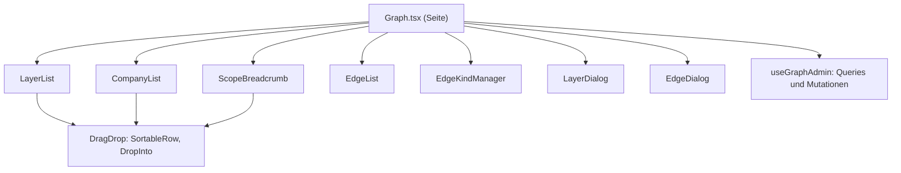
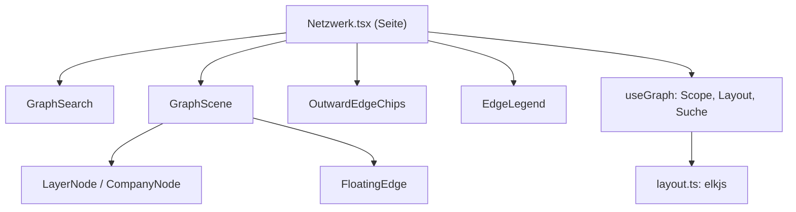
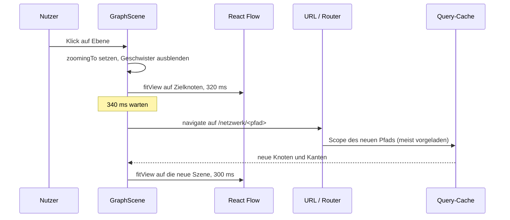

# Netzwerkgraph: Frontend

Zwei getrennte Oberflaechen auf derselben API: der Editor im Admin und die
oeffentliche Visualisierung.

## Admin-Editor

Seite [apps/web/src/pages/admin/Graph.tsx](../../apps/web/src/pages/admin/Graph.tsx)
unter `/admin/graph`, Komponenten in
`apps/web/src/pages/admin/components/graph/`.

Die aktuelle Ebene steht im URL-Parameter `?ebene=<uuid>`. Damit ist jede
Auswahl verlinkbar, und der Browser-Zurueck-Knopf funktioniert ohne
zusaetzlichen Zustand. Die Wurzel ist der Parameter-lose Zustand.

Eine einzige Query versorgt alle drei Listen und beide Dialoge:

| Query-Key | Inhalt |
| --- | --- |
| `["admin","graph","scope",parentId]` | Ebenen, Firmen, Verbindungen, Aussenkanten |
| `["admin","graph","edge-kinds"]` | Verbindungstypen |
| `["admin","graph","companies",parentId,suchbegriff]` | Autocomplete beim Aufnehmen von Firmen |

Alle Mutationen liegen in
[useGraphAdmin.ts](../../apps/web/src/pages/admin/components/graph/useGraphAdmin.ts)
und invalidieren nach Erfolg pauschal `["admin","graph"]` sowie `["graph"]`.
Pauschal deshalb, weil eine Aenderung fast immer mehrere Listen betrifft: Eine
neue Ebene aendert die Ebenenliste, die Dropdowns des Verbindungsdialogs und die
Kinderzahlen der Elternebene.

Fehler werden nicht pro Komponente behandelt, sondern von der Seite als Banner
angezeigt. Die fachlichen 409- und 400-Meldungen der API sind bereits
formuliert und werden unveraendert durchgereicht.

### Drag & Drop

Drag & Drop ist eine reine Komfortschicht: Es ruft dieselben Mutationen auf wie
die Buttons, es gibt keine zweite Schreiblogik. Jede Aktion ist auch ohne Maus
erreichbar, die Sortierpfeile bleiben deshalb erhalten.

| Geste | Wirkung | Mutation |
| --- | --- | --- |
| Zeile innerhalb ihrer Liste ziehen | Reihenfolge aendern | `POST /nodes/reorder` |
| Zeile auf die Zone einer Ebene ziehen | in diese Ebene verschieben | `POST /nodes/:id/move` |
| Zeile auf eine Breadcrumb-Zone ziehen | eine oder mehrere Ebenen hoch verschieben | `POST /nodes/:id/move` |

Die Ablagezonen erscheinen erst waehrend eines Drags. Ohne sie waere die Geste
mehrdeutig: Eine Zeile auf eine andere Ebene zu ziehen koennte "davor
einsortieren" oder "hineinverschieben" bedeuten. Die Zone trennt beide Faelle
sichtbar. Ebenen zeigen keine Zone fuer sich selbst.

Der Anfasser links traegt die Drag-Listener, nicht die ganze Zeile, damit
Klicks auf Buttons und auf den Ebenennamen weiter funktionieren. Der
`PointerSensor` startet erst nach fuenf Pixeln Bewegung, sonst wuerde jeder
Klick als Drag beginnen.

Beide Listen teilen sich den `sort_order`-Raum ihrer Elternebene. Beim
Umsortieren wird deshalb immer die komplette Reihenfolge des Scopes gesendet,
Ebenen zuerst, dann Firmen, nicht nur die bewegte Liste.

## Oeffentliche Ansicht

Seite [apps/web/src/pages/Netzwerk.tsx](../../apps/web/src/pages/Netzwerk.tsx)
unter der Wildcard-Route `/netzwerk/*`, Komponenten in
`apps/web/src/components/graph/`.

Der Pfad in der URL ist der Zustand: `/netzwerk/verarbeitung/compounding` zeigt
genau diese Ebene. Daraus folgt, dass Deep-Links, Browser-Zurueck und die
Escape-Taste ohne Sonderbehandlung funktionieren, denn jede Navigation ist nur
eine Pfadaenderung.

### Ladekette

1. `useGraphScope(path)` holt `GET /api/graph/scope?path=…`,
   Query-Key `["graph","scope",path]`.
2. `useScopeLayout(scope)` berechnet daraus Positionen,
   Query-Key `["graph","layout",signatur]`.
3. `GraphScene` rendert Knoten und Kanten mit `@xyflow/react`.

Die Layout-Signatur besteht aus Pfad, Knoten-Ids, Kinderzahlen und Kanten-Ids.
Ein unveraenderter Scope wird damit nie neu berechnet, ein veraenderter immer.
Weil das Ergebnis `staleTime: Infinity` hat, ist der Ruecksprung in eine schon
besuchte Ebene sofort da.

Beim Hovern ueber eine Ebene wird deren Scope vorgeladen. Der Zoom-Uebergang
dauert rund 320 Millisekunden; in dieser Zeit ist die naechste Ebene meist
bereits im Cache.

### Layout

`elkjs` mit dem Algorithmus `stress`, festem `randomSeed` und stabil nach
`sort_order` sortierter Eingabe. Determinismus ist hier kein Detail: Wer eine
Ebene zweimal oeffnet, muss dasselbe Bild sehen, sonst gibt es keine
Wiedererkennung. Eine kraftbasierte Simulation mit zufaelliger Startlage waere
genau deshalb ungeeignet.

Geschlossene Ebenen werden nach `child_layer_count + child_company_count`
dimensioniert. Die Groesse eines Kreises zeigt so, wie viel dahinter steckt,
ohne dass der Inhalt geladen wird.

Schlaegt die Berechnung fehl, greift ein Raster als Rueckfall. Eine Ansicht mit
unschoenem Layout ist besser als eine leere Ansicht.

### Zoom-Uebergang

Ausloeser der eigentlichen Navigation ist die Pfadaenderung, nicht der Klick.
Der Klick startet nur die Animation. Dadurch fuehrt auch der Weg ueber
Breadcrumb, Escape oder Browser-Zurueck durch dieselbe Ladekette.

`GraphScene` bleibt dabei montiert und tauscht nur Knoten und Kanten aus. Ein
Remount wuerde die Kameraposition verlieren, und genau die traegt den Eindruck
der Bewegung.

### Knoten und Kanten

Kanten werden als `FloatingEdge` gezeichnet: Sie berechnen ihre Ansatzpunkte am
Rand der Knoten selbst, bei Ebenen kreisfoermig, bei Firmen rechteckig. Mit
festen Handles wuerden Linien unter den Knoten hindurchlaufen, weil das
Auto-Layout keine Rueckseiten kennt.

Ein Klick auf eine Firma oeffnet deren Profil unter `/firma/:slug` in einem
neuen Tab. Der Graph bleibt dadurch stehen, wo er ist: Ein Wechsel im selben
Tab wuerde beim Zurueckgehen zwar den Pfad wiederherstellen, nicht aber die
Kameraposition innerhalb der Ebene. Ein Klick auf eine Ebene zoomt hinein.

### Aussenkanten

`OutwardEdgeChips` zeigt am unteren Rand die Verbindungen, die die geoeffnete
Ebene selbst auf Elternniveau hat. Beim Drill-down ist die Elternebene
ausgeblendet, ohne diesen Hinweis ginge verloren, warum die Ebene im Netzwerk
ueberhaupt haengt. Chips zu Ebenen springen dorthin, Chips zu Firmen fuehren auf
das Profil.

### Suche

`GraphSearch` fragt `GET /api/graph/find` ab dem zweiten Zeichen. Jeder Treffer
ist eine Platzierung, nicht eine Firma: Dieselbe Firma kann mehrfach im Graphen
stehen, und der Pfad unter dem Namen zeigt, welche gemeint ist. Die Auswahl
oeffnet die Ebene, in der die Platzierung liegt.

## Feature-Flag und Bundle

`SHOW_NETWORK_GRAPH` in
[apps/web/src/config/features.ts](../../apps/web/src/config/features.ts)
steuert den Navigationslink und den Inhalt der oeffentlichen Seite. Solange das
Flag `false` ist, erscheint dort ein Platzhalter. Die Admin-Pflege ist davon
unabhaengig immer erreichbar, sonst liesse sich der Graph nicht befuellen, bevor
er sichtbar wird.

Die Seite wird per `React.lazy` nachgeladen. React Flow und elkjs wiegen
zusammen rund ein Megabyte; ohne diese Trennung wuerde jeder Besuch der
Startseite sie mitladen. Im Build sind das zwei getrennte Chunks, `index` und
`Netzwerk`.
