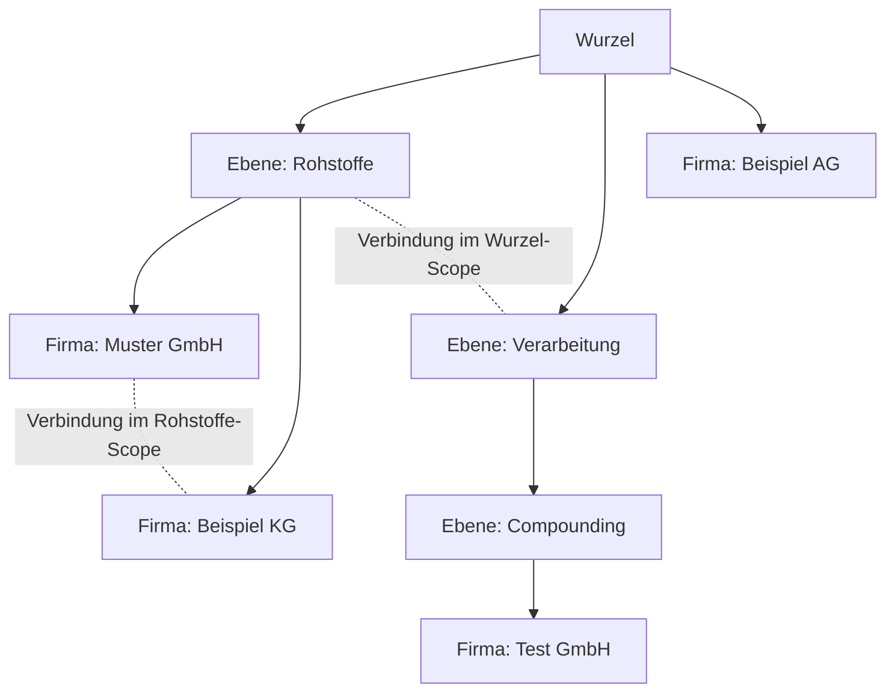

# Netzwerkgraph: Konzept

Der Netzwerkgraph stellt die Beziehungen zwischen den Firmen des CREATE-Clusters
grafisch dar. Er ist kein automatisch abgeleitetes Bild aus den Profildaten,
sondern eine redaktionell gepflegte Struktur: Admins bauen den Graphen im
Backend auf, Besucher navigieren ihn im Frontend.

## Begriffe

| Begriff | Bedeutung |
| --- | --- |
| **Knoten** | Ein Eintrag in `graph_nodes`. Entweder eine Ebene oder die Platzierung einer Firma. |
| **Ebene** (`kind = 'layer'`) | Benannter Container mit Beschreibungstext. Enthaelt Unter-Ebenen und Firmen-Knoten. Gleichzeitig das, was in der Oberflaeche als Cluster erscheint. |
| **Platzierung** (`kind = 'company'`) | Ein Verweis auf eine Firma aus `companies` an einer bestimmten Stelle im Graphen. Die Firmendaten selbst werden nie kopiert. |
| **Scope** | Der Inhalt genau einer Ebene, also deren direkte Kinder plus die Verbindungen zwischen ihnen. Die Wurzel ist der Scope mit `parent_id IS NULL`. |
| **Verbindung** | Eine Kante in `graph_edges` zwischen zwei Knoten desselben Scopes. |
| **Verbindungstyp** | Eintrag in `graph_edge_kinds`; bestimmt Farbe, Richtung und Bezeichnung einer Verbindung. |

## Struktur

Der Graph ist ein Baum aus Ebenen, in dem an jeder Stelle zusaetzlich Firmen und
Verbindungen haengen koennen.

Sichtbar ist im Frontend immer genau ein Scope. Der Klick auf eine Ebene oeffnet
deren Scope und blendet alles andere aus.

## Entscheidungen

### Ein rekursiver Knotentyp statt Ebene plus Cluster

Urspruenglich waren Ebene und Cluster als zwei Konstrukte gedacht. Beide haetten
aber dieselben Eigenschaften gehabt: Kinder aufnehmen, benannt sein, Kanten
tragen. Deshalb gibt es nur einen Typ. Eine Ebene ist der Cluster; ob sie als
Kreis, Kachel oder Flaeche gezeichnet wird, ist eine reine Darstellungsfrage.

Verworfen: getrennte Tabellen `graph_layers` und `graph_clusters`. Das haette
jede Query verdoppelt (Union ueber zwei Typen) und die Kantenlogik verkompliziert,
ohne fachlichen Mehrwert.

Sollte spaeter doch eine nicht-zoombare Gruppierung noetig werden, laesst sich
`kind` um einen dritten Wert erweitern; das Datenmodell bleibt dabei unveraendert.

### Firmen werden referenziert und duerfen mehrfach vorkommen

Ein Firmen-Knoten haelt nur `company_id`. Name, Logo und Status kommen bei jeder
Abfrage frisch aus `companies`, es gibt also keine Kopie, die veralten kann.
Dieselbe Firma darf in mehreren Ebenen platziert werden, weil ein Unternehmen
fachlich in mehreren Wertschoepfungsstufen aktiv sein kann. Pro Ebene ist sie
jedoch genau einmal erlaubt.

Folge fuer die Oberflaeche: Ein Firmen-Knoten ist keine eindeutige Identitaet der
Firma. Die Suche liefert deshalb pro Platzierung einen eigenen Treffer mit
eigenem Pfad.

### Verbindungen nur innerhalb einer Ebene

Eine Kante verbindet ausschliesslich Knoten mit demselben Elternteil. Das folgt
direkt aus der Bedienlogik im Admin, wo beide Endpunkte aus Dropdowns der
aktuellen Auswahl stammen, und hat eine wichtige technische Konsequenz: Jede
Ebene ist ein vollstaendig isolierter Teilgraph. Layout, Laden und Rendern
brauchen nie mehr als den Inhalt einer einzigen Ebene, unabhaengig davon, wie
gross das Gesamtnetzwerk wird.

Verworfen: ebenenuebergreifende Kanten. Sie haetten beim Drill-down entweder
ins Leere gezeigt oder ein globales Layout erzwungen.

Beziehungen zwischen Bereichen werden stattdessen auf der jeweils passenden
Ebene modelliert: Zwei Firmen in verschiedenen Ebenen sind mittelbar dadurch
verbunden, dass ihre Ebenen eine Verbindung haben.

### Kein gespeichertes Layout

Positionen werden nicht persistiert. Der Admin waehlt pro Ebene, wie ihre
Kinder gezeichnet werden, sobald man die Ebene oeffnet:

| Modus | Darstellung |
| --- | --- |
| `graph` | Netzwerk mit `elkjs`, Verbindungen sichtbar. Das ist der Standard. |
| `pie` | Torte. Jedes Kind ein Stueck, Unterebenen nach Firmenzahl, einzelne Firmen mit Gewicht 1. Verbindungen bleiben gespeichert und werden nicht gezeichnet. |
| `xy` | Portfolio. Firmen auf den Achsen Unternehmensgroesse und hoechster Technologie-Reifegrad (TRL). Unterebenen stehen als Kreise ueber dem Diagramm. Verbindungen ebenfalls nur gespeichert. |

Die Wurzel hat keine Zeile in `graph_nodes`. Ihr Modus liegt in `app_settings`
unter `graph_root_layout`. Inhalt und Modus sind unabhaengig: eine Ebene darf
jedes der drei Bilder zeigen, egal ob darin Ebenen, Firmen oder beides liegen.

Bei `graph` berechnet `elkjs` die Positionen. Da ein Scope selten mehr als
einige Dutzend Knoten hat, ist das in Millisekunden erledigt. Wichtig ist
Determinismus: Bei gleicher Eingabe muss dasselbe Bild entstehen, sonst geht
die Wiedererkennung verloren. Deshalb ein deterministischer Algorithmus statt
einer zufaellig initialisierten Kraftsimulation, und eine stabil nach
`sort_order` sortierte Eingabe. Torte und Portfolio sind ebenfalls fest aus
den Daten abgeleitet, inklusive eines festen Versatzes, wenn mehrere Firmen
auf derselben Zelle liegen.

Verworfen: manuelle Koordinaten pro Knoten. Das haette den Admin um eine
Canvas-Interaktion erweitert und bei jeder Strukturaenderung Nachpflege
verlangt. Drag & Drop im Admin veraendert deshalb nur Struktur und Reihenfolge,
nie die Optik.

### Drill-down statt semantischem Zoom

Beim Klick auf eine Ebene werden Geschwister und Elternebene ausgeblendet; es
ist immer genau ein Scope sichtbar. Dadurch entfaellt jede Notwendigkeit fuer
verschachteltes Rendering, und die Datenmenge pro Ansicht bleibt konstant.

Der Preis ist Orientierung, die aktiv hergestellt werden muss:

- Breadcrumb mit dem vollstaendigen Pfad, jede Station anklickbar.
- Ebenenpfad in der URL, damit Deep-Links und Browser-Zurueck funktionieren.
- Animierter Zoom beim Wechsel, damit der Sprung als Hineingehen lesbar bleibt.
- Chips am Rand fuer die Verbindungen, die die geoeffnete Ebene selbst nach
  aussen hat und die im Inneren sonst unsichtbar waeren.
- Globale Firmensuche, die den Pfad zu einer Firma aufloest.

### Oeffentliche Sichtbarkeit

Der Graph ist ohne Login erreichbar und zeigt ausschliesslich Firmen mit
`status = 'approved'`. Ausgefilterte Firmen ziehen ihre Kanten mit, damit keine
Linien ins Leere zeigen. Im Admin bleiben nicht freigegebene Firmen sichtbar und
werden als solche gekennzeichnet.

Offener Punkt fuer den fachlichen Betrieb: Anders als alle bisherigen
Profildaten stammen die Verbindungen nicht von den Firmen selbst, sondern aus
redaktioneller Pflege. Sie machen Geschaeftsbeziehungen oeffentlich sichtbar, die
die beteiligten Firmen nicht selbst eingetragen haben. Empfehlenswert ist
deshalb entweder eine Abstimmung mit den Firmen oder eine bewusst
unverbindliche Semantik der Verbindungstypen (etwa "Kooperation" statt
"liefert an"). Der ausgelieferte Standardsatz an Typen ist entsprechend
zurueckhaltend gewaehlt.

## Abgrenzung

Der Graph ersetzt nicht die Suche. Die Suche beantwortet "welche Firma kann X",
der Graph beantwortet "wie haengt das Netzwerk zusammen". Beide greifen auf
denselben Firmenbestand zu, teilen aber keine Filterlogik.
